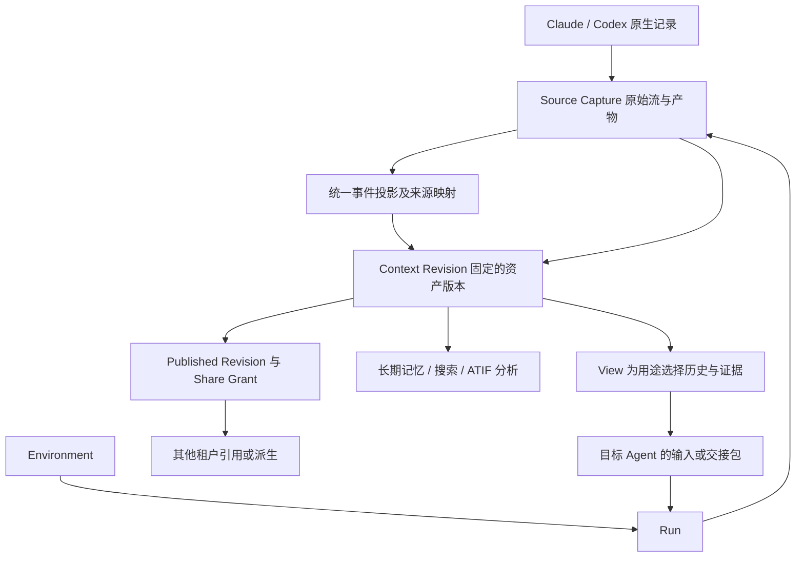

# Context 作为跨 Agent 长期资产：研究与设计依据

研究日期：2026-10-31；原生结构复核更新：2026-11-01。状态：设计前研究，尚未冻结交换格式，也未实现生产接入。

当前先梳理[Context 与协作功能清单](../../product/context-collaboration.md)。功能范围确认后，再收敛技术方案；以下材料作为调研参考。

当前顺序明确为：**先确认原生档案内容与依赖，研究官方恢复和 fork，再验证跨 Agent 转换，最后判断是否需要通用内容层。** [架构修订](architecture.md)与[核心协议契约](protocol-contract.md)保留为待验证候选，不作为已选定方案。最新依据见[原生完整性与生命周期复核](native-storage.md#9-原生完整性与生命周期复核)。

本文回答三个问题：Claude Code / Codex 的上下文实际由什么组成；现有项目和协议解决到了哪一层；如果 Context 要跨 Agent、跨租户流转并长期分析，哪些约束必须先确定。

配套材料：

- [稳定性优先的架构修订](architecture.md)：成熟度甄别、直接采用的规范、首期边界、存储事务与故障验收。
- [核心协议契约](protocol-contract.md)：内容描述符、事件信封、版本清单、兼容扩展、提交和共享语义。
- [原生存储与恢复语义](native-storage.md)：版本、目录、事件结构、有效历史、官方导入和本仓库现状。
- [来源与审阅范围](sources.md)：项目、固定提交、直接证据、研究边界。
- [合成探针结果](evidence/asp-probes.json)及[复现方法](evidence/README.md)：六个最小输入案例；不含真实会话内容。
- [本地结构观察](evidence/local-observations.json)：仅记录版本、类型、字段和汇总数量。

## 1. 研究结论

**原生会话档案可以直接成为 Context 的持久化内容；保存它们不以统一消息协议为前提。** Codex、Claude Code、Pi 的原生记录通常包含详细历史，官方恢复和 fork 就使用这些材料。但“足以继续会话”“保留了从头到尾的原始历史”“精确记录每次模型请求”是不同保证。尤其要检查压缩后的清理、fork 的历史引用、子会话与附件依赖。

跨 Agent 转换作为独立的派生操作验证；仅在直接转换暴露出重复且稳定的公共语义时，再决定是否提炼薄层。本文后续涉及通用模型、服务与协议的章节是前期候选，不能倒过来约束原生档案如何被保存。

这不是因为现有项目缺少转换能力。恰恰相反，已经有转换器、会话包、带出处的交接摘要、上下文数据库和协作平台。问题是它们承诺的保真范围不同：

| 用户要完成的事 | 必须保存/构造的东西 | 不能据此推断的能力 |
|---|---|---|
| 在同一个 Agent 中恢复会话 | 原生记录及该版本要求的运行状态 | 可在另一 Agent 中等价恢复 |
| 让另一 Agent 接着工作 | 任务目标、约束、决策、证据、未完成事项及必要历史 | 所有原生状态均已转移 |
| 长期审计和重新分析 | 有出处的原始记录、附件、版本、采集覆盖范围 | 当前模型应读入全部历史 |
| 多租户共享 | 明确发布的内容版本、授权与派生关系 | 共享整个活跃会话或执行环境 |
| 挖掘长期知识 | 可追溯的事实、时间、冲突/修订、提取过程 | 摘要或提取结果就是原始事实 |

几个会影响设计的实证发现：

1. **Claude 的 transcript 有分支，Codex 的历史有 rollback、compaction 和分页投影。** 按文件顺序拼接所有文本无法等价重建当前有效上下文。官方实现也有专门的重建逻辑。[Claude SDK 会话读取实现](https://github.com/anthropics/claude-agent-sdk-python/blob/2146f9d8985513053e904b13200c8f744b36785a/src/claude_agent_sdk/_internal/sessions.py)、[Codex 历史重建](https://github.com/openai/codex/blob/36650394c5b38c2990ccf2a3457165ca3e9d9726/codex-rs/core/src/session/rollout_reconstruction.rs)。
2. **官方也区分“保存原生会话”和“跨工具导入”。** Claude SDK 的 SessionStore 要求保留不透明原生记录；Codex 的 Claude 导入会把工具内容转成文本说明并截断。后者解决继续工作的入口，没有承诺资产无损。[SessionStore](https://code.claude.com/docs/en/agent-sdk/session-storage)、[Codex 导入转换实现](https://github.com/openai/codex/blob/36650394c5b38c2990ccf2a3457165ca3e9d9726/codex-rs/external-agent-migration/src/sessions/records_common.rs)。
3. **TUTTI 是很好的协作与恢复参考，但不能直接视为跨 Agent 上下文交换协议。** 它把 canonical session 与 provider session 分开，严肃处理 fork 的一致性；研究提交的设计文档明确排除了跨 provider fork。[TUTTI fork 设计](https://github.com/tutti-os/tutti/blob/207beeea554435618dffd3b579d0ffe112b065c4/docs/specs/2026-07-27-agent-session-fork-design.md)。
4. **长期分析已有可借鉴的格式。** Harbor ATIF 对轨迹、工具、子 Agent、指标和复制上下文有明确模型；OpenViking、Graphiti 对分层检索和带时间的派生知识有实践。适合做分析出口和派生层参考，不能直接替代原生会话档案。[ATIF 模型](https://github.com/harbor-framework/harbor/blob/5eb713ff9500daced4e143b98765a7c732744a1b/src/harbor/models/trajectories/trajectory.py)、[OpenViking 归档](https://github.com/volcengine/OpenViking/blob/012e1f0c83405664c07d371c4f4d77a013015253/openviking/session/archive_store.py)、[Graphiti 时间与证据边](https://github.com/getzep/graphiti/blob/72b5c59c06607e09ea855be61b6ff5a3446fc951/graphiti_core/edges.py)。

## 2. 研究方法与可信度

检索覆盖六类：原生 Agent 存储、跨 Agent 转换、会话归档、多人/多 Agent 协作、长期记忆、交换与观测标准。TUTTI 是起点之一，未作为唯一候选。

证据分四层，全文不将它们混同：

- **本机观察**：实际安装版本、有限范围的原生 JSONL 结构、SQLite schema 与统计；没有复制用户对话、工具输出或凭据到报告。
- **固定版本源码**：核心类型、解析、恢复、迁移等指定文件。代码存在不代表已在本环境集成成功。
- **官方文档/规范**：记录其当前状态；提案、开发中规范不当作既成行业标准。
- **合成探针**：ASP 六个解析案例；本次补充 Claude 官方 fork 纯函数三个案例、Pi 官方上下文投影及模型转换纯函数四个案例。不是完整 CLI 会话回放或原生恢复验收。[运行证据](evidence/README.md)。

研究没有执行真实会话跨工具导入，没有启动新的模型调用，也没有部署中转服务器。完整范围见[来源登记](sources.md)。

## 3. 原生结构对通用层的约束

| 维度 | Claude Code | Codex | 对我们格式的要求 |
|---|---|---|---|
| 会话原件 | project 目录下 JSONL，子 Agent 与 sidecar 可独立存在 | rollout JSONL 与多个 SQLite 索引/投影并存 | 原始流、索引、附件分别建模；记录来源版本 |
| 历史关系 | `uuid`、`parentUuid`、sidechain、压缩边界；并行工具结果有特殊关联 | turn/item、rollback、replacement history、window、retained context | 不能只有线性文本数组；保存顺序和因果/分支关系 |
| 对外读取 | SDK 提供过滤、重建后的消息视图；SessionStore 提供原生记录镜像 | App Server 提供 thread/turn/item 视图和分页；rollout 是另一层结构 | 明确拿到的是哪种视图，不把 API 输出冒充完整原件 |
| 工具调用 | `tool_use` / `tool_result` 内容块 | function/custom tool 调用及输出、规范化 item | 保留原生工具名、参数、调用关联；语义映射是派生结果 |
| 模型专有内容 | thinking、signature 等 | reasoning summary、可能有 `encrypted_content` | 不透明内容按来源保存；不声称可以跨模型解释或重放 |
| 环境 | cwd、Git 信息、工具和权限等 | cwd、workspace roots、sandbox/approval 等 | 保存环境证据；执行权限由新的运行环境重新决定 |
| 长期记忆 | 项目/用户 memory 与 transcript 分离 | 本地另有 memory 相关状态 | 记忆是独立来源或派生资产，不能只采集聊天文本 |

本机 Codex 0.157.1 的 310 条 thread 记录中，309 条标记为 paginated，但全部仍能定位到 rollout 文件。因此，“新版迁移到 SQLite，JSONL 已经不重要”在本环境不成立。Claude 本机 CLI 是 2.1.203，而审阅的 Python SDK 是 0.2.176，二者不能不加区分地宣称拥有相同接口。详细证据及局限见[原生分析](native-storage.md)。

## 4. 最值得借鉴的开源实践

### 4.1 TUTTI：借鉴边界与一致性，而非照搬整个平台

搜索发现多个同名项目。本文重点研究与“人和 Agent 协作”描述最匹配的 [tutti-os/tutti](https://github.com/tutti-os/tutti/tree/207beeea554435618dffd3b579d0ffe112b065c4)；另一个 [nutthouse/tutti](https://github.com/nutthouse/tutti/tree/6b86cca7457364888032e6ff9c04f2a87fc14cb2) 主要是编排 CLI，不将两者的能力混写。

TUTTI 的可取之处是：平台维护自己的 session/turn/message 身份，同时保留 provider session/turn 的映射。Fork 前冻结来源边界及快照，记录操作状态，验证 provider 能力，然后提交独立的 canonical session。能力查询也检查 driver kind/version 和状态绑定方式，而非“支持这个 Agent”就默认支持所有 fork。[Host 接口](https://github.com/tutti-os/tutti/blob/207beeea554435618dffd3b579d0ffe112b065c4/packages/agent/host/types.go)、[能力判断](https://github.com/tutti-os/tutti/blob/207beeea554435618dffd3b579d0ffe112b065c4/packages/agent/host/session_fork_capabilities.go)。

落地存储中也区分 effective / retracted turn、history revision 和恢复状态；fork 操作有 request hash、snapshot hash、prepared/accepted/committed/unknown 等状态。**这说明历史身份、当前有效性、执行是否成功，应是不同维度。** [历史迁移](https://github.com/tutti-os/tutti/blob/207beeea554435618dffd3b579d0ffe112b065c4/packages/agent/store-sqlite/migrations_effective_history.go)、[fork 存储](https://github.com/tutti-os/tutti/blob/207beeea554435618dffd3b579d0ffe112b065c4/packages/agent/store-sqlite/migrations_session_fork.go)。

另一个有价值的设计是被动 reference URI：引用标识与可读标签分开，由当前工作区解析权限和实际资源。但它解析的是当前资源，不能自动当作历史时点的证据。我们需要在类似引用上增加不可变 revision 或内容摘要。[Reference mention 解析](https://github.com/tutti-os/tutti/blob/207beeea554435618dffd3b579d0ffe112b065c4/docs/architecture/agent-reference-mention-resolution.md)。

边界同样重要：该提交的 fork 文档明确不支持跨 provider fork，也排除了 worktree/filesystem snapshot、含 session-local attachment 的边界和 provider-native descendant lane。它是成熟问题拆分的参考，不是“跨租户通用 Context 已解决”的证据。[范围限制](https://github.com/tutti-os/tutti/blob/207beeea554435618dffd3b579d0ffe112b065c4/docs/specs/2026-07-27-agent-session-fork-design.md#11-当前限制与后续)。

### 4.2 txcript：很直接的转换器参考，但 Common 模型不宜成为资产底座

[txcript](https://github.com/skillsynchq/txcript/tree/c60e686e7ed30e67019288eed80c4be478512d64) 区分原生 body 与 Common transcript；Common 包含文本、工具、图片、推理/签名等块，并记录部分 session lineage。这种“原生保留 + 通用转换”的边界值得借鉴。

不过，当前 Common 明确不记录来源 harness；消息没有统一稳定 ID，role 只有 user/assistant，lineage 尚未写回原生导出。Claude codec 主要按文件顺序转换；Codex codec 在所读分支中将 encrypted reasoning 置空。**类型定义能表达某字段，不代表所有适配器都已保留它。** [Common 类型](https://github.com/skillsynchq/txcript/blob/c60e686e7ed30e67019288eed80c4be478512d64/src/common.rs)、[Claude codec](https://github.com/skillsynchq/txcript/blob/c60e686e7ed30e67019288eed80c4be478512d64/src/harness/claude_code.rs)、[Codex codec](https://github.com/skillsynchq/txcript/blob/c60e686e7ed30e67019288eed80c4be478512d64/src/harness/codex.rs)。

选择建议：可作为适配器候选和格式研究材料；资产身份、版本、来源和授权由我们自己的层负责。是否直接依赖，需先通过当前原生版本的兼容性语料验证。

### 4.3 Agent Session Protocol：统一事件流有用，不能默认有归档保真

[ASP](https://github.com/kevin-dp/agent-session-protocol/tree/470b9242d8c5eb5a35b6b330405b8edd52756a06) 提供 session、message、tool、permission、compaction 等统一事件，也做工具名归一。它很适合展示“薄事件层”如何开始；但当前公共事件没有完整的稳定事件身份和分支图，文本归一也会筛掉部分内容。[类型](https://github.com/kevin-dp/agent-session-protocol/blob/470b9242d8c5eb5a35b6b330405b8edd52756a06/src/types.ts)。

对固定提交的两个 normalizer，用完全虚构的输入实际运行，得到：

| 最小输入 | 实际输出 | 对长期资产的含义 |
|---|---|---|
| Claude 两个兄弟分支 | 两个分支文本均被输出，分支关系消失 | 不能用输出直接代表当前有效分支 |
| Claude 文本 + image + 未知 block | 仅留下文本 | 必须另存原件和损失说明 |
| Codex 消息 + rollback + 替代消息 | 被撤回文本仍在，rollback 消失 | 不能把归一后的数组当有效上下文 |
| Codex paginated `item_completed.UserMessage` | 空数组 | 新版本事件覆盖需显式测试 |
| Codex 未知事件 | 未知事件被跳过 | 未来解析器无法从该输出补回信息 |
| Codex compaction + replacement history | 默认从最后 compaction 开始，替代历史未保留 | “压缩后继续”不等于“裁掉压缩前行” |

这是适用范围检查，不是六种真实完整会话的原生恢复测试，也不是对项目总体质量评分。它说明我们不能以“解析器成功返回 JSON”作为互操作验收。[输入、输出与复现](evidence/README.md)、[Codex normalizer](https://github.com/kevin-dp/agent-session-protocol/blob/470b9242d8c5eb5a35b6b330405b8edd52756a06/src/normalize/codex.ts)。

### 4.4 Moirai 与 SCTXX：会话包和交接摘要是两个不同产品

[Moirai](https://github.com/october-dev/moirai/tree/2f371b357e68e35eaf5e9ebf1994b03f1591507f) 有带版本的 transcript、provenance、附件/unknown block、转换 warning 和带 SHA-256 的 archive。值得借鉴的是 **可携带包、完整性检查、损失诊断**。但 archive hash 针对归一后的 transcript；它不能证明原生记录已完整保存。当前 codec 对部分原生记录会省略或降级。[模型](https://github.com/october-dev/moirai/blob/2f371b357e68e35eaf5e9ebf1994b03f1591507f/model.go)、[归档](https://github.com/october-dev/moirai/blob/2f371b357e68e35eaf5e9ebf1994b03f1591507f/archive.go)。

[SCTXX](https://github.com/handyutils/sctxx/tree/37d60265877e79724dd5412096659fccc0eaf31e) 的目标更接近交接：IR 保存 native ID、parent、原始行定位、未知事件，并区分全量事件与 active view；再把历史折叠为带来源的约束、进展等状态。校验器验证来源范围、可见事件以及用户约束引文是否出现，失败操作被拒绝。这类机械校验能约束摘要生成，却不能证明摘要推断完全正确。[IR](https://github.com/handyutils/sctxx/blob/37d60265877e79724dd5412096659fccc0eaf31e/src/ir.rs)、[来源校验](https://github.com/handyutils/sctxx/blob/37d60265877e79724dd5412096659fccc0eaf31e/src/pipeline/fold/validate.rs)。

两个项目都较新；本次只做源码审阅，没有运行其 LLM 摘要流程。建议把 Moirai 看作 package 参考，把 SCTXX 看作 derived handoff 参考，均不直接定为底层标准。

### 4.5 Entire：把会话变成可追溯资产的实践

[Entire CLI](https://github.com/entireio/cli/tree/54b6a5cac34e5ff939e6e5871168da9ffd4d187a) 区分活跃 session state 和持久 checkpoint，把经过清理的 transcript、元数据与代码提交关联；checkpoint 可以使用单独 Git ref 保存自身历史。也有研究/规划等无文件变更会话的 snapshot 路径。[Session / checkpoint 模型](https://github.com/entireio/cli/blob/54b6a5cac34e5ff939e6e5871168da9ffd4d187a/docs/architecture/sessions-and-checkpoints.md)、[ref 后端](https://github.com/entireio/cli/blob/54b6a5cac34e5ff939e6e5871168da9ffd4d187a/docs/architecture/ref-checkpoint-backend.md)。

可借鉴的是“会话证据 + 明确快照 + 代码来源关联”。我们的 Context 应可引用 Git commit，但也能在没有仓库、没有 worktree 时独立存在。Git 的仓库权限也不能替代跨租户、按 Context revision 授权的服务模型。

### 4.6 OpenViking / Graphiti / Hindsight：为长期挖掘准备数据，而非只积累聊天

OpenViking 使用 URI 和分层内容表示资源、记忆、技能；session 归档保留 messages，再生成摘要和长期记忆。工具输出还有 raw reference、截断标志、原长度、hash 等信息，明确区分展示片段与原始产物。它提醒我们：**检索摘要可以重做，原始证据和覆盖范围不能依赖摘要是否成功。** [Context 模型](https://github.com/volcengine/OpenViking/blob/012e1f0c83405664c07d371c4f4d77a013015253/openviking/core/context.py)、[消息/工具产物](https://github.com/volcengine/OpenViking/blob/012e1f0c83405664c07d371c4f4d77a013015253/openviking/message/message.py)、[归档状态](https://github.com/volcengine/OpenViking/blob/012e1f0c83405664c07d371c4f4d77a013015253/openviking/session/archive_store.py)。

Graphiti 把 episode 与提取出的事实分开，事实边保留源 episode 和有效/失效/记录时间。可借鉴的是来源与时间修订语义：今天修正一个判断，不能抹去过去曾据此行动的证据。其 `group_id` 可做数据分区，但“有分区字段”本身不构成我们的跨租户访问控制。[节点](https://github.com/getzep/graphiti/blob/72b5c59c06607e09ea855be61b6ff5a3446fc951/graphiti_core/nodes.py)、[事实边](https://github.com/getzep/graphiti/blob/72b5c59c06607e09ea855be61b6ff5a3446fc951/graphiti_core/edges.py)。

Hindsight 的 retain/recall/reflect 和 document 更新语义，是记忆生命周期参考。例如同一 document ID 的更新会影响已提取记忆，不能把记忆结果当 append-only 原始日志。我们未审计其全部实现或验证官方效果数据。[Retain API](https://hindsight.vectorize.io/developer/api/retain)。

这几类系统可以成为后续分析消费者；首期没有必要引入知识图谱或完整 memory runtime。OpenViking 当前仓库许可证元数据是 AGPL-3.0，直接采用前还需按选定版本评估；本文的架构借鉴不意味着已决定引入依赖。

### 4.7 Harbor ATIF：优先考虑兼容的分析出口

研究提交的 ATIF 默认版本为 1.8。它明确区分 run 范围的 `session_id` 与文档范围的 `trajectory_id`，支持子 Agent trajectory 和 continuation；step 包括工具、观察、指标，多模态内容另有类型。`is_copied_context` 可避免把 fork 复制的旧内容重复算成新生成行为。[Trajectory](https://github.com/harbor-framework/harbor/blob/5eb713ff9500daced4e143b98765a7c732744a1b/src/harbor/models/trajectories/trajectory.py)、[Step](https://github.com/harbor-framework/harbor/blob/5eb713ff9500daced4e143b98765a7c732744a1b/src/harbor/models/trajectories/step.py)。

这是本次对“后续分析、评测、挖掘”最直接的格式参考之一。不过有序 trajectory 的主要边界是一次运行或其片段；我们的 Context 还需跨运行组合、版本、授权、增量采集和原件保留。因此建议验证 ATIF 导出，避免另造一套封闭分析生态；暂不直接把 ATIF 当完整资产协议。

### 4.8 其余候选的定位

| 候选 | 本次审阅范围 | 可借鉴内容 / 不直接采用的原因 |
|---|---|---|
| [Letta AgentFile](https://docs.letta.com/v1-sdk/concepts/agent-file) | 官方文档 | Agent 配置、记忆、工具、消息和 in-context 标记的可携带包；文档位于 V1 区域，不是跨 CLI 原生恢复标准 |
| [Acontext](https://github.com/memodb-io/Acontext/tree/1ddfd903fd1004672ca9f9a70d92041153ba43d5) | 文档与仓库状态 | session / artifact / memory 的服务分层；研究时仓库已 archived，不宜未经后续核实成为新核心依赖 |
| [Mem0](https://github.com/mem0ai/mem0/tree/753496cf1435d76c3a711f3af51303f7fdcb6420) | 文档 | 记忆提取与检索；不等价于完整执行历史归档 |
| [CASS](https://github.com/Dicklesworthstone/coding_agent_session_search/tree/30f96a3dbed4f18e99ff205541fa97528eeba3e7) | 文档 | 跨工具索引与查询体验；搜索成功不能证明可完整恢复 |
| [Git AI](https://github.com/git-ai-project/git-ai/tree/8a6184a3a8fc4e997ccfff3b16d79688e4255af4) | 文档 | 代码来源追踪；不是会话资产协议 |
| [Buzz](https://github.com/block/buzz) | 官方项目介绍 | 协作通信参考；本次未审计其 context 存储核心，不据此宣称解决跨 Agent 保真 |

## 5. 标准如何分工

没有在本次范围内找到同时覆盖“原生归档、跨 Agent 语义、版本血缘、跨租户授权、长期分析”的已确立统一标准。这是有边界的检索结论，不是对整个行业的穷尽证明。

| 规范 | 已解决的主要问题 | 与本方案的关系 |
|---|---|---|
| [MCP Resources，2025-11-25](https://modelcontextprotocol.io/specification/2025-11-25/server/resources) | 资源 URI、列举、读取、订阅，由 host 决定如何纳入上下文 | 可作为 Context 的读取入口；不是归档、分支或授权模型的替代 |
| [ACP v1 Session setup](https://agentclientprotocol.com/protocol/v1/session-setup) | 编辑器/客户端与 Agent 的 session 创建、加载、更新流 | session/load 不等价于把 Agent A 原生状态迁移到 B |
| [A2A v1.0.1](https://a2a-protocol.org/v1.0.1/specification/) | Agent 间任务、消息、产物、contextId 关联 | 可传 Context 引用；其上下文关联与任务生命周期不等于长期资产完整性 |
| [OpenTelemetry GenAI](https://github.com/open-telemetry/semantic-conventions-genai/blob/main/docs/gen-ai/gen-ai-spans.md) | 调用/Agent span、指标、可选内容与外部内容关联；规范仍在 Development | 适合可观测性出口。即使配置内容上传，也需单独验证覆盖与保留，不能默认就是完整档案 |
| [Agent Trace 0.1.0 RFC](https://agent-trace.dev/) | 代码文件/范围的贡献来源及 conversation 引用 | 适合 Artifact → Run/Context 的来源链接；不是完整对话模型 |
| [W3C PROV-DM](https://www.w3.org/TR/prov-dm/) | Entity / Activity / Agent，以及使用、生成、派生、归属关系 | 可借用来源语义；首期不必引入 RDF 或完整 PROV 实现 |

因此可以先定义自己的**内部资产契约**，为 MCP、ATIF、OTel 等提供适配；等 Claude/Codex 兼容性语料和真实协作使用稳定后，再考虑独立发布通用协议。

## 6. 三种路线的取舍

| 路线 | 优点 | 主要代价 | 判断 |
|---|---|---|---|
| 直接 Claude ↔ Codex 双向转换 | 两种工具时实现路径短 | 任一格式更新都影响转换；资产身份/授权另做；新增 N 种工具时潜在 N×(N−1) 个方向 | 可以做接入实现，不能作为长期资产模型 |
| 全部转换成统一 messages / trajectory | 检索和展示简单 | 分支、未知事件、运行状态易丢；不断扩张 schema 才能追上各家 | 不适合作为唯一真实来源 |
| 原生保存 + 小语义核心 + 可再生视图 | 兼顾保真、演进、分析和不同用途 | 初期要定义身份、出处、版本与投影边界 | **建议方向** |

第三条路线中的“薄”指**少而明确的公共承诺**，不是信息少。核心统一的是身份、出处、关系、内容引用和版本；provider-specific runtime state 留在有命名空间的扩展或原生对象里。完整工具参数不必先拆成一个跨平台大工具枚举。

## 7. 建议先确定的概念边界

以下是候选领域模型，不是已经定稿的 JSON schema；名称也可在验证后调整。

### 7.1 Context、原生 Session 与 Run 不应一一对应

- **Context**：由某租户管理、有稳定身份的上下文资产，可包含多个来源或运行的证据。
- **Revision**：固定选择范围和内容的版本，引用原件、投影与附件；分享和分析优先固定到 revision。
- **Source Session / Stream**：Claude/Codex 等实际产生的原生会话或事件流；保留 provider ID 和来源设备/实例范围。
- **Run**：某 Agent 在某环境的一次执行，声明使用了哪些 revision/view，并生成新记录。一次执行可消费多个 Context。
- **View / Handoff**：为读取、检索、交接或模型预算生成的视图。它不是资产本身，可以失败、过期或被新算法替代。
- **Environment Binding**：Run 对 worktree、仓库、终端、凭据、工具等环境的绑定。Context 可以记录当时环境的证据，但不负责创建或独占 worktree。

这保留了用户期望的工作方式：先选择 Context，再自行选择或创建环境；新 Run 将二者关联。导入 Context 本身不触发 checkout、工具执行或权限继承。

### 7.2 格式需要保护的十二项不变量

1. **原件可追溯**：每个公共事件能回到来源流、native ID 或具体记录位置；一个原生记录拆成多个公共事件时保留映射。
2. **未知内容可保留**：无法识别的类型进入 opaque 原件/扩展并记录诊断；不能只在日志里写一句 skipped。
3. **身份与内容摘要不同**：相同文本可发生多次；hash 可验证内容，不替代 event ID、顺序、作者真实性或授权。
4. **因果不靠时间猜**：分别保存流内顺序、发生时间、采集时间、parent/reply/tool-call 关联；跨流不存在天然总顺序。
5. **历史与有效性分开**：撤回、fork、compaction 都保留证据；由指定版本的规则生成当前有效历史。
6. **覆盖范围可声明**：记录完整/局部采集、起止 cursor、截至位置、损坏/截断/缺失。无法证明完整时不标 full。
7. **产物独立可寻址**：图片、patch、文件、工具输出用可校验的 artifact 引用；只有本地路径时明确标 unavailable / external。
8. **转换损失可解释**：输出包含 feature 级 exact / normalized / lossy / unsupported 说明，并区分未知与不支持；不能只给成功布尔值。
9. **派生结果有生成过程**：摘要/记忆保留源 revision、证据 ID、提取器/模型/提示版本、时间和状态；不覆盖原件。
10. **旧指令不自动升级权限**：历史 system/developer/tool 内容保留作者与来源身份，作为材料输入新 Agent；当前指令和工具权限由接收方决定。
11. **授权不藏在内容里**：资产 owner、内容 revision、ShareGrant 分开；跨租户去重不能泄露存在性或绕过授权。
12. **可删除与可演进**：不可变是版本语义，不代表永久无法删除；保留撤销/删除标记并使索引、摘要和缓存失效。协议版本、adapter 版本、原生版本分别记录。

原生原件的“无损”也要明确层次：文件 capture 可保留并校验原始字节；SDK 镜像通常承诺 JSON 内容等价，不承诺原始空白、键顺序和字节排列。两者不应使用同一个模糊的 lossless 标签。

### 7.3 合并 Context 不是拼接消息

两个租户或 Agent 可以从同一 revision 派生，之后产生不同判断。建议先支持 **引用、派生、显式组合视图**。冲突结论以各自证据保留，由新的分析或用户决策解决，并记作新的 revision。

暂不要求 CRDT 自动合并语义事实，也不因底层实现 append-only 就宣称冲突已解决。先保证不会丢失、错接分支或把过期结论当最新事实。

## 8. 多租户与中转服务器

建议把共享操作定义为一个明确的发布过程：

1. 租户 A 本地采集并形成私有 revision。
2. A 选择消息/时间段/主题/附件范围，产生待发布视图。
3. 生成**固定发布版本**及依赖清单，检查引用附件、原始工具输出和摘要是否意外带出未选内容。
4. 中转服务保存获准发布的对象，创建面向 B 或组织的 ShareGrant。
5. B 选择引用该版本，或在允许复制/派生的条件下生成自己的 Context，并保留来源关系。
6. B 在自己的环境启动 Run；新内容默认属于 B，不自动写回 A，也不自动转授权给第三方。

第一期可优先支持“选定 revision 的快照共享”，把持续跟随活跃 session 留作单独能力。否则发布后追加的一条敏感消息可能未经再次选择就被同步出去。

| 概念 | 建议语义 |
|---|---|
| 发布内容 | 固定 revision 和附件闭包，不隐含整个源 session |
| 引用 | 使用原 owner 管理的内容；每次读取检查 grant |
| 派生/复制 | 产生接收方资产，保留来源、允许范围和导出策略 |
| 撤销 | 阻止后续授权读取/同步；无法召回已被对方合法下载的明文副本 |
| 检索 | 在候选检索、附件读取、模型输入、缓存返回各边界执行租户和授权检查 |
| 派生索引/记忆 | 继承可见范围或记录来源 grant，撤销/删除时可失效和重建 |

原生档案与发布包可以是不同存储域：私有完整原件留本地或私有 vault，中转服务只接收经过选择的发布版本。未知原生字段可以在私有档案保留，却不能因为“需要无损”而默认跨租户发送。

“中转”还存在一个必须明确的产品取舍：

- **服务端可读授权内容**：可在服务端做全文、向量检索与分析，运维和访问控制责任更重。
- **端到端加密的盲中转**：服务端保管密文和授权元数据，明文检索/挖掘通常在客户端或另行授权的计算端进行。

不能同时默认承诺“服务端看不到内容”和“服务端任意分析内容”。Context 格式可以兼容两种部署，但首个产品实现应明确选择一种信任模型。这是设计决策，不是现在就要用户批准部署。

## 9. 长期资产与挖掘：从第一天保留哪些信息

未来较有价值的分析可能包括：哪些决策后来被推翻、哪个工具失败导致改方案、不同 Agent 的交接遗漏了什么、哪些约束跨任务持续有效。只有问答文本和一份最终摘要，很难可靠回答这些问题。

建议从一开始保留：

- 决策/约束的来源与修订关系，事实发生时间和被记录时间。
- 模型、Agent、工具、adapter 版本，以及真实可获得的 usage/失败状态；缺失值不能填成 0 或凭空估算成官方指标。
- 原始工具结果与展示片段的关系、文件/代码的版本证据、内容缺失标记。
- fork/复制历史的来源，区分“被带入上下文的旧事件”和“本次新发生的事件”，避免分析重复计数。
- 摘要和抽取产物的证据范围、生成版本及撤销/更新机制。

评估方面，LongMemEval 的跨会话检索、时间推理、知识更新和拒答维度可借鉴；LongMemEvalV2 对环境中的动态事实和可复用流程的区分也有参考价值。但它们不是 coding-agent 原生格式兼容性测试，不能直接搬用其分数作为我们的质量承诺。[LongMemEval](https://arxiv.org/abs/2410.10813)、[LongMemEvalV2](https://arxiv.org/abs/2605.12493)。

需要同时测两类质量：**数据保存与重建是否忠实**，以及**给定预算的交接是否帮助继续完成任务**。只测摘要相似度或 token 节省，无法证明第二点。

## 10. 设计前的验证路径

不建议下一步直接搭一个拥有很多字段的 v1 server。更有价值的是一个受控的兼容性实验，再由结果约束协议。

| 阶段 | 交付物 | 通过条件 |
|---|---|---|
| A. 固定语料与证据等级 | Claude/Codex 指定版本的干净会话夹具；原生与 API 视图对照 | 普通对话、工具、多模态、并行、子 Agent、fork、rollback、compaction、新旧格式和部分损坏均有明确预期 |
| B. 三层原型 | 原件 capture、语义投影、有效 view；不先实现多租户 UI | 可重建来源映射；重复采集幂等；未知字段保留；损坏/缺失不静默跳过 |
| C. 双向交接比较 | 官方迁移、候选转换器、证据型 handoff 的对照 | 分开报告原生恢复、历史导入、任务交接；逐特性列出损失与不支持 |
| D. 最小共享实验 | 一次固定 revision 发布、一次授权读取、一次派生与撤销 | 不越界读取附件/索引；更新不会自动扩大分享范围；记录来源和实际可撤销边界 |
| E. 分析出口 | ATIF 导出与少量可追溯分析问题 | 不重复计数复制上下文；结论可以回到原始证据；删除/修订能使派生结果失效 |

其中 A–C 应先于协议字段冻结。还需要区分“同工具恢复成功”和“跨工具任务继续成功”：前者依赖 provider 版本与原生状态，后者即使经过有损 handoff 也可能成功，但不能据此宣称无损。

目前可以先确定：Context / Run / Environment 分离，原件与派生视图分离，固定 revision 作为分享单位，未知内容和转换损失可追踪。暂缓确定：完整 JSON 字段、所有工具类型枚举、自动语义合并、知识图谱技术栈、公开标准名称与跨工具 exact-resume 承诺。

## 11. 与宿主应用的接入边界

Context 模块应能独立存储和解释原生档案，向宿主应用提供展示或接续所需的视图。宿主现有的聊天展示、最近会话定位和工具输出截断，不应成为原件采集的唯一来源。[接入边界](native-storage.md#7-与宿主应用的接入边界)。

Worktree 创建和环境管理由宿主负责，在启动运行时关联 Context。当前仓库提供研究材料与验证探针，尚未实现生产接入。
