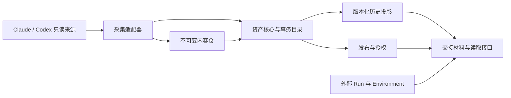

# Context 资产层：稳定性优先的架构修订

日期：2026-10-31；状态更新：2026-11-01。状态：待验证的架构候选，尚未选定或实现。当前先研究原生档案、官方恢复与 fork，再由转换实验决定是否需要通用内容层；见[原生完整性复核](native-storage.md#9-原生完整性与生命周期复核)。

本文记录基于“可靠的行业契约、缩小范围、深入处理故障”提出的候选方案。下文“正式交付”“必须”等表述均属于该候选内部的设计要求，不代表产品范围或协议已经确认；不得用它们替代原生能力验证。

## 1. 产品收敛：先做好一个可靠的 Context 资产仓库

首个正式版本聚焦：**只读采集 Claude/Codex → 固定可校验的 Context 版本 → 生成带出处的可读交接材料 → 由租户显式发布固定版本 → 另一租户引用并在自己的环境使用。**

长期分析所需的证据、版本和派生关系从第一天保留；自动记忆、图谱、智能合并与多 Agent 编排延后。Worktree 继续由外部环境管理。

| 前期开放方向 | 本次收敛 |
|---|---|
| 通用 Agent 事件模型可能不断扩大 | 稳定核心只约束来源、内容、版本、完整性和引用；具体对话语义属于有版本的投影 |
| 参考多个新兴 Agent 项目的格式 | 新项目提供案例和适配思路；基础信封、内容引用、校验和 HTTP 行为采用已有规范 |
| 同时讨论恢复、导入、交接 | 首期交付可读、可追溯的交接；原生恢复单独验收，暂不作为核心承诺 |
| 多种存储/运行/分发方式 | 先实现一种单节点持久化方案；以契约隔离未来的物理后端 |
| 共享可能包含动态订阅、复制和合并 | 首期固定版本、显式授权、只读引用；持续跟随与自动转授权延后 |

“先收缩”不降低已有功能的要求。一个已确认保存的版本不能因解析器异常消失；一个看似完整的交接包不能隐瞒缺失的工具结果；一条被撤回的历史不能因转换方便而成为当前结论。

## 2. 如何甄别实践质量

评价对象是**某个具体契约或模块**，不以整个项目的热度、语言或功能数量代替质量判断。进入基础层的依赖至少应回答：

1. 有没有发布的版本、明确的兼容边界和规范性要求？
2. 有没有独立实现、验证工具或公开测试套件，能够检查我们是否遵守？
3. 是否明确失败、重试、未知内容、扩展和完整性的语义？
4. 治理、维护和缺陷处理是否有公开机制？选定版本是否已核查相关已知缺陷？
5. 它解决的问题是否正好落在本模块边界，还是需要引入大量无关运行时？

这些条件决定采用等级，不给缺乏证据的项目编造数值评分。成熟度与适配度也分别判断：长期归档规范可能成熟，却未必适合直接作为在线多租户服务模型。

### 2.1 基础层直接采用的契约

| 契约 | 质量依据 | 具体采用 | 明确边界 |
|---|---|---|---|
| CloudEvents 1.0.2 | 发布规范；多语言 SDK；CNCF 毕业项目 | 采集/派生事件的信封与身份规则，采用 structured JSON；`specversion` 仍为 `1.0` | 不提供投递、事务或因果排序保证；不要求引入消息队列 |
| OCI Image Spec 1.1.1 的 Descriptor | 发布规范明确鼓励其他格式嵌入 descriptor | 内容引用的 `mediaType`、`digest`、`size` 及其验证语义 | 不因此采用镜像 manifest、Registry、容器运行时或镜像层语义 |
| JSON Schema 2020-12 | 有明确 dialect 和独立测试套件 | 协议文档形状与字段校验；固定验证器和测试基线 | 它不能单独校验引用闭包、权限或历史语义；不称其为已完成的 IETF RFC |
| HTTP RFC 9110 | Internet Standard | 幂等资源操作、强 ETag、`If-Match` 并发更新 | 不能靠 HTTP 方法名称自动得到业务幂等或跨存储事务 |
| RFC 9457 | 发布的 Standards Track RFC | 机器可读的 Problem Details 错误 | 我们仍需定义稳定的领域错误类型 |

直接依据：[CloudEvents 版本与治理](https://cloudevents.io/)、[核心规范](https://github.com/cloudevents/spec/blob/v1.0.2/cloudevents/spec.md)、[JSON 格式](https://github.com/cloudevents/spec/blob/v1.0.2/cloudevents/formats/json-format.md)、[OCI Descriptor](https://github.com/opencontainers/image-spec/blob/v1.1.1/descriptor.md)、[JSON Schema](https://json-schema.org/draft/2020-12/json-schema-core)、[验证套件](https://github.com/json-schema-org/JSON-Schema-Test-Suite)、[HTTP 条件请求](https://www.rfc-editor.org/rfc/rfc9110.html#section-13.1.1)、[Problem Details](https://www.rfc-editor.org/rfc/rfc9457.html)。

这是一组协议组件，不是五个必须部署的服务。核心需要自行设计的部分缩小到 Context revision、采集覆盖范围、投影出处及发布授权之间的关系。

### 2.2 借鉴原则、暂不完整采用的实践

| 实践 | 值得采用的原则 | 本次判断 |
|---|---|---|
| OCFL 1.1 | 自描述清单、版本内容不可随意改写、定期完整性检查、脱离原应用仍可理解资产 | 归档领域有明确规范和验证规则；先借用原则，不强制其目录/版本布局，也不宣称 OCFL 合规 |
| LangGraph persistence | thread checkpoint 与跨 thread store 分开；恢复必须考虑已完成工作的持久记录 | 官方文档给出清晰的状态边界；借鉴 checkpoint 与派生记忆分离，不引入 graph runtime |
| Claude SessionStore / Codex 官方读取面 | 以原生契约读取、保留 provider 专有状态 | 对来源语义权重最高；仍需按 CLI/SDK 版本固定验证 |
| TUTTI | canonical/provider 身份分离、明确 fork 边界、有效/撤回历史及恢复状态 | 已有实质源码和设计证据，但不能据此认定跨 provider 通用格式已经稳定 |
| ATIF | 独立的轨迹分析格式、子轨迹和复制上下文标记 | 后续分析出口候选，不进入首期核心持久化依赖 |
| txcript / ASP / Moirai / SCTXX | 格式差异、损失说明、来源校验和反例语料 | 保留为适配器研究与测试参考；当前证据不足以让其 Common 模型成为基础存储契约 |
| OpenViking / Graphiti 等记忆系统 | 原件与提取结果分离、来源与时间修订 | 保留扩展方向；暂不部署记忆服务或图数据库 |

新增依据：[OCFL 规范](https://ocfl.io/1.1/spec/)、[实现建议](https://ocfl.io/1.1/implementation-notes/)、[LangGraph persistence](https://docs.langchain.com/oss/python/langgraph/persistence)、[checkpoint 恢复](https://docs.langchain.com/oss/python/langgraph/checkpointers)。其余固定源码、观察与局限沿用[来源登记](sources.md)。本轮没有为这些项目增加未经执行的性能或恢复成功率声明。

## 3. 首期能力边界

### 3.1 正式交付范围

- Claude Code 与 Codex 的**明确版本范围**内，只读采集本地来源；未知版本可封存原件，但不默认生成“完整有效历史”。
- 不可变 revision、附件/工具产物的内容引用、完整性验证、可导出清单、备份及恢复检查。
- 确定性生成的可读历史与交接材料，包含来源、缺失和转换报告。首期不依赖 LLM 摘要成功才能保存或使用 Context。
- 一个部署内的租户身份隔离，显式发布固定版本，向指定租户授予只读访问，支持撤销未来访问。
- 接收方在自己运行中引用交接材料；继续产生的新记录形成自己的 Context，保留允许公开的来源关系。

多租户上线前必须接好经过验证的身份认证和授权边界；本地原型不等于多租户正式版本。单用户宿主的可信网络假设不能直接沿用到共享服务。

### 3.2 延后范围

原生会话文件伪造/写回、跨 Agent exact resume、整个子 Agent 树的等价恢复、实时协同编辑、自动语义合并、动态分享“以后所有消息”、跨部署联邦、图谱/向量记忆、复杂分析 UI、多后端并行支持、多节点高可用、端到端加密服务端检索。

附件和子流在模型中有明确位置。首期某适配器未覆盖它们时，必须报告边界；不能因为暂缓完整支持，就删除来源记录或把部分结果标成完整。

## 4. 结构：小核心、受控适配器、可重建的投影

先采用模块化单体，不拆微服务。模块职责限制如下：

| 模块 | 负责 | 不接管 |
|---|---|---|
| 采集适配器 | 来源识别、版本探测、流与 cursor、原件收集、能力报告 | 分享权限、工具执行、业务摘要 |
| 内容仓 | 不可变字节、digest/size 校验、受控读取、保留与回收 | 消息含义和 Agent 恢复逻辑 |
| 资产核心 | revision 提交、来源与依赖、完整性、控制状态事务 | provider-specific message 枚举 |
| 历史投影 | 指定版本下的有效分支、工具关联、可读视图及损失报告 | 修改原件、隐式执行历史工具调用 |
| 发布与授权 | 固定发布内容、访问主体、权限校验、撤销 | 自动同步来源的未来内容 |

主依赖方向是适配器/投影依赖核心契约；核心不 import Claude/Codex 的内部类型。Context 之外的 Run 记录消费了哪个 revision/view，Environment 由现有运行系统提供。

核心长期稳定的对象只有几类：**Context 身份、Revision 清单、Source 流与覆盖范围、Blob 描述符**。Projection、Publication、Grant 位于明确的扩展或控制边界，不把所有业务概念塞进一张消息表。

## 5. 协议先固定语义，再固定全部字段

详细规则见[协议契约](protocol-contract.md)。这里先确定六项架构决定：

1. **Revision 是固定版本，不是正在增长的 session。** 它引用截至明确位置的来源内容；后续追加产生新 revision。
2. **清单与内容分离，身份与 digest 分离。** 清单通过 OCI Descriptor 引用字节；Context ID 表示资产身份，digest 只标识特定字节内容。
3. **原件与解释结果分离。** 解析器升级生成新 Projection，不修改旧 revision 或把新解释覆盖成旧事实。
4. **完整性与可用性分别表达。** “字节校验通过”“采集范围完整”“语义可重建”“可生成某种交接”是不同状态。
5. **内容依赖与来源引用分别表达。** 交接包必需的附件进入发布闭包；“派生自某私有 Context”不意味着接收方可以读取该私有 Context。
6. **授权与内容版本分离。** 改权限不改内容 hash；新内容也不会沿用旧授权自动发布。

必须在初版中明确：重复请求如何识别、相同身份内容冲突如何处理、未知必需能力如何拒绝、缺失来源如何报告、撤销与读取如何界定先后。这些语义将比字段命名更难在上线后修改。

对于可以延后的细节，保留明确的扩展点即可：更细的工具分类、摘要结构、图片预览形式、分析指标等，都不改变原件和 revision 的身份语义。

## 6. 首期存储：一种实现，把持久性做完整

### 6.1 物理方案

建议首期只实现**单节点 SQLite 事务目录 + 本机持久盘上的不可变内容仓**。当前仓库已经使用 better-sqlite3；新模块应有自己的 schema 和所有权边界，不将原生 Agent 数据库或其表结构当成我们的数据库。

| 存储 | 权威内容 |
|---|---|
| 不可变内容仓 | 原始字节、清单、附件、投影产物；按租户/安全域隔离 |
| SQLite 事务目录 | 已提交 revision、归属、head 指针、发布/授权/撤销状态、采集 cursor、幂等身份和待处理任务 |
| 可重建索引 | 事件检索、列表加速、历史展示；丢失可从原件与清单重建 |

**权限与撤销记录不是可随意丢弃的索引。** 数据库和对象均须备份。仅保留 blobs 不能重建所有控制状态。

该部署可服务多个租户，但采用一个受控服务写入，所有访问经过授权；不允许客户直接访问数据库或内容目录。SQLite WAL 需要同机共享内存，不用网络文件系统承载活跃数据库。资产提交应采用明确的持久化设置，例如 WAL 配合 `synchronous=FULL`；不能只打开 WAL 就宣称断电后已确认事务仍可靠。[SQLite WAL 条件](https://www.sqlite.org/wal.html)、[原子提交与前提](https://www.sqlite.org/atomiccommit.html)。

成熟组件仍需固定可靠版本。实施时记录实际 `sqlite_version()` 和编译配置，核查持久化相关缺陷，不能仅看 npm 包版本。具体到已公开的 WAL-reset 修复，官方说明在 3.51.3 起及部分官方回移版本中提供；所选构建需确认包含修复并通过目标平台验收。本文不将当前 package.json 的依赖范围视为已验收版本。[SQLite 官方说明](https://www.sqlite.org/wal.html#the_wal_reset_bug)。

后续确有多节点需求时，再实现事务数据库和对象存储后端。协议中的 descriptor、revision 与控制状态契约不随数据库品牌改变。首期不为假想后端编写多套实现。

### 6.2 提交顺序与崩溃恢复

采用“内容先持久化，事务目录后提交”的顺序：

1. 将新内容写入受控临时位置，边写边校验长度和摘要；完成所选平台要求的持久化步骤。
2. 原子安装为不可变对象；已有对象须验证一致，不覆盖不同内容。仅 rename 不等于已经跨断电持久化，文件与目录处理须按平台验收。
3. 验证 revision 的内容依赖、来源覆盖和 schema；缺失对象时不提交。
4. 在一个数据库事务中记录 revision 及其对象引用、幂等身份、适用的采集 cursor 和待处理任务；成功提交后才确认。
5. 展示投影可稍后执行；失败保留明确状态，重试不回滚已保存原件。

| 中断位置 | 重启后的正确结果 |
|---|---|
| 临时文件写到一半 | 没有成功确认；清理或续传临时内容，cursor 不跳过 |
| 对象已安装、目录事务未提交 | 允许出现孤立对象；按原身份重试，不能出现已提交但指向缺失内容的 revision |
| 事务已提交、响应丢失 | 相同身份重试返回原结果，不重复生成版本 |
| 投影执行中崩溃 | 原件和 revision 仍可读取；重试或生成明确失败记录 |
| 内容后来损坏 | 校验失败并隔离，不伪造正常读取；从已验证备份恢复 |

采集需要至少一次重试和幂等入库，不承诺端到端 exactly-once。通知与任务通过同一事务中的待处理记录可靠衔接，首期不引入 Kafka/NATS。所谓“重放”仅限数据处理，不执行历史 shell 或其他外部副作用。

跨机器同步时分别记录本地持久采集位置、远端确认位置和投影进度。本地保存并登记待发送任务后可以继续采集；远端确认提交前不能清理未确认的本地内容。一次网络超时不能同时推进这几个位置，也不能把“本地已保存”显示成“远端已备份”。

### 6.3 回收、备份与容量

- 回收以已提交内容依赖为依据，覆盖私有 revision、发布版本和进行中的上传保留；来源引用本身不等于持有全部来源内容。
- 回收前要有宽限期，避免与提交竞争；删除先变更访问/引用状态，后做物理回收。
- 备份取得一致的数据库快照并保留其引用对象，在验证备份闭包完成前禁止相关对象被回收；不能只复制一个正在写入的 `.sqlite` 文件。
- 恢复演练须检查对象校验、revision、权限和撤销记录。索引可重建，原件与授权不能靠猜测恢复。
- 上传大小、并发、队列和磁盘余量必须有限制。磁盘满、配额满、超大记录都返回明确失败，不静默截断。

单节点持久化确认只描述本节点的存储保证。整盘损坏、异机备份的 RPO/RTO 需要单独测量和公开，不能从事务成功推导出异地灾备能力。

## 7. 多租户先做到边界清楚

采用一个可信部署内的显式授权共享，不先做跨服务器联邦。租户来源取自服务端认证结果，不能相信导入包中的 owner/tenant 字段。

发布流程固定为：选择来源 → 生成独立发布清单与必要内容 → 检查闭包和内容范围 → 原子创建发布记录与授权 → 接收方按版本读取。

这里有一个很容易忽略的细节：私有原始块可能同时包含允许分享与未允许分享的消息。**给接收方一个原始块的下载权限，再要求它只读其中几行，仍然泄露了其他内容。** 发布阶段必须生成仅包含已选内容的新对象，重新计算摘要；私有来源映射由拥有者受控保存。

读取验证的是“这个主体是否被授权读取这个发布版本，以及该对象是否属于其内容闭包”。知道 digest、source URI 或某个父版本 ID 不构成读取权。首期不做跨租户全局去重，也不开放可绕过授权的裸 hash 下载入口。

撤销阻止撤销提交后新获准的读取；已经传输或被合法下载的明文不能召回。首期由服务端代理读取并检查授权，避免长效对象 URL 绕开撤销。正在进行的读取和撤销须有定义好的授权判定时点，不能宣称可以追回已经发出的字节。

只读引用已经足以让另一 Agent 使用资料。接收方产生的新成果保留来源，但不能依靠格式约束防止其记住或转述已读明文；转授权范围是服务与使用策略，不伪装成 DRM。

## 8. 适配器要按能力验收

不使用单一的 `supportsClaude=true`。每个适配器声明来源格式/版本、能力和证据基线：

| 能力 | 最低验收 |
|---|---|
| Capture | 来源身份稳定，范围/游标明确；重复、半行、替换文件、未知类型不会导致静默丢失 |
| Reconstruct effective history | 与指定版本的可信来源视图对照；fork、rollback、compaction、并行工具关联通过 |
| Materialize handoff | 输出只引用选定内容；缺失与损失可见；不把历史指令升格为当前权限 |
| Native restore | 独立的真实运行验收；首期不对外承诺 |

未知 CLI 版本可以停留在 Capture 能力。未知结构若可能影响有效历史，允许继续归档，但暂停完整交接声明。可处理的未知展示 metadata 可以透传并报告；两类未知不能一刀切。

新增解析规则使用新 adapter/projection 版本，旧原件不变。迁移允许并存对照，确认一致后才更新默认读取版本，保留回退到旧投影的路径。

## 9. 稳定性如何成为发布门槛

首期测试重点放在真实故障与契约，不围绕实现细节堆覆盖率。下列是待实施的验收要求，不是本次已经通过的测试。

| 验收组 | 必须验证的情形 |
|---|---|
| 标准契约 | CloudEvents/OCI Descriptor/所用 JSON Schema dialect 的有效和无效输入；规范版本与实现版本匹配 |
| 内容真实性 | 字节翻转、错误长度、未知 media type、缺失依赖、重复 JSON key、大整数边界 |
| 重试与并发 | 重复提交、同 ID 不同内容、响应丢失、并发推进 head、超时后查询原结果 |
| 崩溃恢复 | 在对象写入、安装、数据库提交、响应、投影各边界注入中断 |
| 来源变化 | 半行、截断、同路径文件替换、相同 native ID 重复出现、时钟回拨、子流延迟出现 |
| 原生兼容 | 两种 Agent 的固定版本语料及官方读取面；compaction/rollback/fork/并行工具和附件边界 |
| 版本演进 | 老 reader 对可选扩展保留，对未知必需能力拒绝；新 reader 读旧版本；迁移后回退 |
| 租户与发布 | 跨租户猜 ID、未选行/附件泄露、私有来源反查、撤销后读取、缓存权限变化 |
| 运维恢复 | 满盘、权限错误、数据库忙、对象损坏、备份中断、恢复后权限/撤销状态一致 |

协议验收套件应独立于业务 UI，随协议版本发布。适配器的 golden corpus 需要人工/原生基线确认，不能把现有解析器的输出反过来当唯一正确答案。上一轮六个合成 ASP 探针仍只是研究证据。

为了获得有意义的可靠性结论，还应公开采集延迟、投影失败、缺口、损坏、重试和授权拒绝的指标；日志不包含默认全文。容量、延迟、备份恢复目标由固定测试环境得出，尚未测量前不宣称 SLA。

## 10. 决策状态与下一步

**本轮建议固定的架构决策**：成熟协议组件；不可变版本与内容；控制状态事务；原件与投影分离；固定版本分享；Run/Environment 外置；首期一种单节点后端；能力分级与故障验收。

**暂不冻结的细节**：完整字段命名、分块阈值、UI 形态、摘要/工具分类、分析格式插件、多节点实现。先在[协议契约](protocol-contract.md)规定的边界内，用 Claude/Codex 语料验证，再发布内部 0.x schema。

实现顺序为：协议契约及反例语料 → 本地采集/提交/校验与恢复 → 有效历史和可读交接 → 身份/发布/授权与撤销 → 双 Agent、双租户日常试用。每一步完成故障门槛后再扩展能力，避免先铺开界面再补数据语义。
